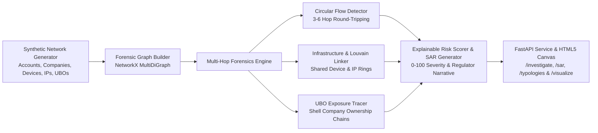

# Multi-Hop Financial Forensics & Entity Link Toolkit


A graph intelligence and financial crime forensics toolkit built with **NetworkX** and **FastAPI** to uncover hidden money laundering rings, mule device farms, and layered Ultimate Beneficial Ownership (UBO) exposure across multi-hop entity networks—complete with automated **SAR narrative generation** and an **interactive HTML5 ego-network explorer**.

---

## Architecture Overview



---

## Financial Crime Typologies Detected

| Typology | Graph Pattern | Forensic Detection Logic |
| :--- | :--- | :--- |
| **Circular Flow (Round-Tripping)** | Directed Cycles ($A \rightarrow B \rightarrow C \rightarrow D \rightarrow A$) | Identifies funds returning to the originating entity within 3–6 hops with bounded value decay (<25%). |
| **Mule Ring / Device Farm** | Bipartite / Star & Louvain Clustering | Links seemingly unrelated retail accounts sharing identical `LOGGED_IN_FROM` device hashes or `CONNECTED_VIA` IP exit nodes. |
| **Hidden UBO Exposure** | Multi-Hop Ownership Path | Traverses `HELD_BY` and `OWNED_BY` edges across layered shell companies to flag proximity to sanctioned or PEP beneficial owners. |

---

## API Endpoints

| Method | Endpoint | Description |
| :--- | :--- | :--- |
| `GET` | `/health` | Service health check and graph node/edge summary statistics. |
| `GET` | `/investigate/{entity_id}?hops=3` | Multi-hop forensic risk score, severity rating, and triggered typologies. |
| `GET` | `/investigate/{entity_id}/sar?hops=3` | Compiles a regulator-ready Suspicious Activity Report (SAR/UAR) narrative. |
| `GET` | `/typologies/cycles` | Scans the graph for 3–6 hop circular round-tripping rings. |
| `GET` | `/typologies/communities` | Detects clustered mule rings via Louvain community detection. |
| `GET` | `/visualize/{entity_id}?hops=3` | Renders an interactive, draggable HTML5 Canvas ego-network explorer in the browser. |

---

## Quickstart & Local Execution

### 1. Clone & Install

```bash
git clone https://github.com/oscartandi/fin-forensics-entity-linker.git
cd fin-forensics-entity-linker
python -m venv .venv
source .venv/bin/activate  # On Windows: .venv\Scripts\activate
pip install -r requirements.txt
```

### 2. Run Automated Tests

```bash
python -m pytest -v
```

### 3. Launch Forensic Investigation API

```bash
python -m uvicorn src.api:app --reload
```

#### Example Investigation Request

```bash
curl http://127.0.0.1:8000/investigate/ACC_301?hops=3
```

```json
{
  "entity_id": "ACC_301",
  "forensic_risk_score": 50,
  "risk_severity": "HIGH",
  "detected_typologies": [
    "HIDDEN_SANCTIONED_UBO_EXPOSURE"
  ],
  "ubo_exposures": [
    {
      "high_risk_entity": "PER_PEP_01",
      "label": "Sanctioned_Beneficial_Owner",
      "hops_away": 3,
      "ownership_chain": ["ACC_301", "COMP_SHELL_B", "COMP_SHELL_A", "PER_PEP_01"]
    }
  ]
}
```
