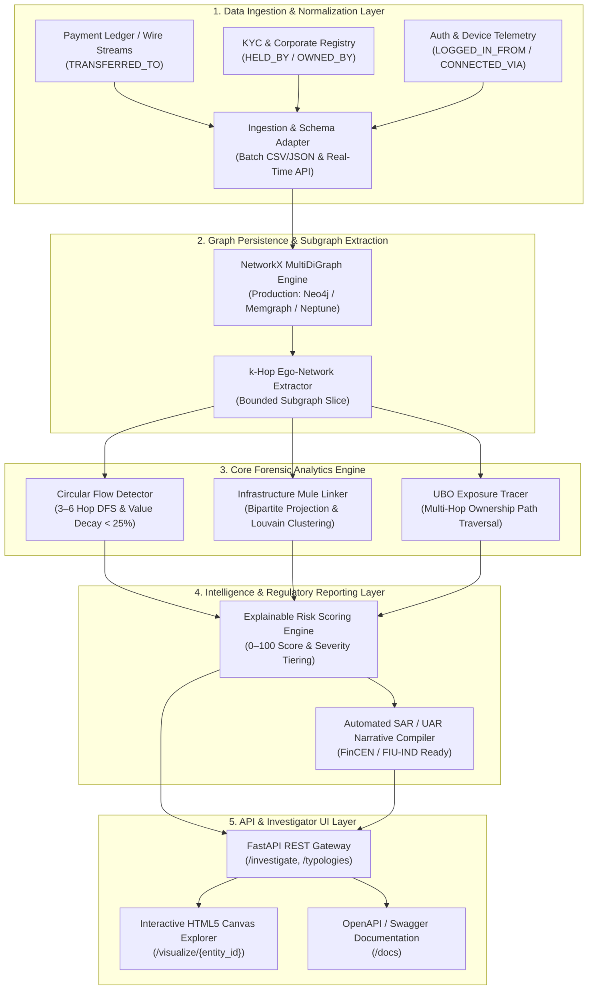

# High-Level Design (HLD): Multi-Hop Financial Forensics & Entity Link Toolkit

## 1. System Overview & Objectives
The **Multi-Hop Financial Forensics & Entity Link Toolkit** is an enterprise-grade graph intelligence and financial crime investigation platform. Built on **FastAPI** and **NetworkX**, it ingests multi-source banking, corporate registry, and device telemetry data to construct a directed property multigraph, uncover hidden money laundering rings, detect shared mule device farms, and trace layered Ultimate Beneficial Ownership (UBO) exposure—complete with automated Suspicious Activity Report (SAR/UAR) generation and interactive ego-network visualization.

### Core Objectives
* **Multi-Hop Entity Resolution:** Uncover indirect relationships (3–6 hops) across accounts, corporate shells, devices, and IP exit nodes that rule-based SQL queries miss.
* **Typology-Driven Detection:** Automate detection of Circular Flow (Round-Tripping), Mule Device Farms, and Sanctioned/PEP UBO Exposure.
* **Explainable Risk Scoring:** Generate deterministic, auditable 0–100 risk scores alongside human-readable regulatory SAR narratives.
* **Production Scalability Path:** Designed with a clean separation between graph storage/ingestion and forensic subgraph analysis so it can transition seamlessly from in-memory NetworkX to distributed graph databases (Neo4j, Memgraph, Amazon Neptune) and streaming ingestion (Kafka).

---

## 2. System Architecture Diagram

---

## 3. Component Responsibilities

| Layer | Component | Responsibility |
| :--- | :--- | :--- |
| **Ingestion** | `graph_builder.py` / Ingestion Adapter | Validates and normalizes entity attributes (`Account`, `Company`, `Person`, `Device`, `IP`) and directed relationships into a unified graph schema. |
| **Core Engine** | `forensics.py` | Executes multi-hop subgraph extraction, bounded cycle detection, Louvain community modularity clustering, and UBO ownership traversal. |
| **Compliance** | `sar_generator.py` | Translates triggered typologies, counterparties, transaction chains, and ownership paths into structured, regulator-ready SAR/UAR narratives. |
| **Visualization** | `visualizer.py` | Renders a zero-dependency, interactive HTML5 Canvas force-directed ego-network explorer with node inspection and typology highlighting. |
| **API Gateway** | `api.py` | Exposes RESTful investigation, typology-scanning, health monitoring, and visualization endpoints with Pydantic validation. |

---

## 4. End-to-End Investigation Data Flow

1. **Entity Query:** An investigator or automated alert triage system calls `GET /investigate/{entity_id}?hops=3`.
2. **Ego-Subgraph Extraction:** The engine extracts the undirected/directed $k$-hop neighborhood around `entity_id` to isolate relevant counterparties, devices, and shell companies.
3. **Parallel Typology Evaluation:**
   * **Round-Tripping Check:** Scans directed transaction paths returning to `entity_id` within 3–6 hops with $\le 25\%$ value shrinkage.
   * **Mule Ring Check:** Evaluates shared device hashes and IP exit nodes using Louvain community detection.
   * **UBO Exposure Check:** Traverses `HELD_BY` and `OWNED_BY` edges to identify indirect ownership links to PEP or Sanctioned individuals.
4. **Scoring & Triage:** Aggregates triggered typology weights into a capped `0–100` forensic risk score (`LOW`, `MEDIUM`, `HIGH`, `CRITICAL`).
5. **Actionable Output:** Returns structured JSON evidence, renders an interactive visual graph (`/visualize/{entity_id}`), or compiles a full SAR narrative (`/investigate/{entity_id}/sar`).

---

## 5. Production Scaling Architecture (Real-Time Enterprise Deployment)

To scale from prototype datasets to **10M+ nodes and real-time transaction streams**:
* **Streaming Ingestion:** Replace batch startup loading with **Apache Kafka / Redpanda** consumers (`payments.settled`, `auth.device_events`) executing idempotent `MERGE` upserts with sliding time-to-live (TTL) windows.
* **Distributed Graph Store:** Persist the full enterprise graph in **Neo4j**, **Memgraph**, or **Amazon Neptune**. Pull only the compact $k$-hop neighborhood (<500 nodes) into NetworkX per investigation request in `<15 ms`.
* **Asynchronous Execution:** Run global graph algorithms (all-graph Louvain clustering and global cycle scans) via scheduled background jobs (Neo4j GDS / Spark GraphFrames) and cache community IDs on vertex properties for $O(1)$ API lookup.
